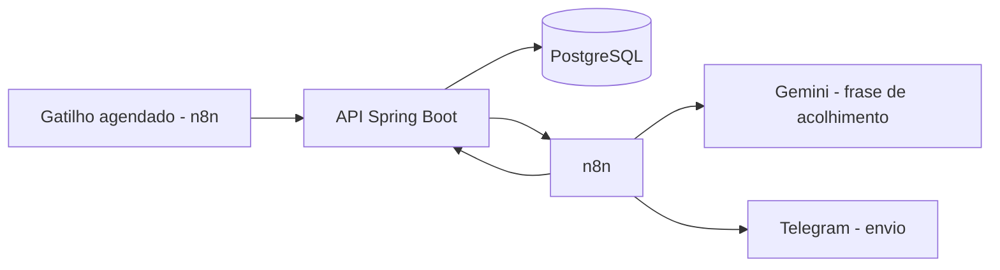

# Barbearia Lembretes IA

Automação de **confirmação e lembrete de agendamentos** para barbearias, com API própria em Spring Boot, orquestração no n8n e IA generativa para personalizar o tom das mensagens.

> Projeto de portfólio. Todos os dados de exemplo são fictícios.

## O problema
Recepções perdem tempo enviando lembretes manualmente, e as faltas de clientes deixam horários vazios.

## A solução
Duas mensagens automáticas por agendamento:

| Mensagem | Quando | Conteúdo |
|---|---|---|
| **Confirmação** | Todo dia às 17h, para os agendamentos de amanhã | Saudação personalizada pela IA, barbeiro, data/hora e link de confirmação |
| **Lembrete** | A cada 15 min, para quem está a 45–60 min do horário | Texto fixo: "Falta 1 hora para o seu horário. Aguardamos por você!" |

## Arquitetura



1. O n8n consulta a API pelos agendamentos pendentes.
2. A IA gera só uma frase curta, **sem receber nenhum dado pessoal** do cliente.
3. O n8n monta a mensagem final com os dados vindos do banco e envia.
4. O n8n avisa a API que o envio ocorreu, e a API registra o log.

## Stack
Java 21, Spring Boot, Spring Data JPA, PostgreSQL 16, Flyway, Docker Compose, n8n, Google Gemini, Telegram Bot API.

## Decisões de projeto
- **Dados críticos nunca passam pela IA.** Barbeiro, data, hora e link vêm do banco. Se o Gemini falhar ou a cota acabar, o fluxo usa uma frase padrão e a mensagem sai completa.
- **Sem duplicidade de envio.** Cada tipo de mensagem tem a sua coluna de controle (`confirmacao_enviada_em` e `lembrete_1h_enviado_em`).
- **Janela de 45 a 60 minutos** com execução a cada 15 min: cada agendamento cai em uma janela só, e quem marca em cima da hora não recebe um "falta 1 hora" errado.
- **Fuso horário** tratado explicitamente (`America/Sao_Paulo`); o banco guarda `TIMESTAMPTZ`.
- **Banco versionado com Flyway:** mudanças de esquema viram migrations (`V1`, `V2`).
- **Histórico de envios** em `lembretes_log` (tipo, mensagem, modelo, tokens, status), para auditoria e controle de custo.
- **Cancelados não recebem lembrete.**

## Como rodar
Pré-requisito: Docker Desktop.

```bash
git clone https://github.com/wkel-code/barbearia-lembretes-ia.git
cd barbearia-lembretes-ia
docker compose up -d --build
```

- API: http://localhost:8080
- n8n: http://localhost:5678

**Importar os fluxos no n8n:** *Import from File* com `n8n/confirmacao-17h.json` e `n8n/lembrete-1h.json`. Depois, crie as credenciais do Telegram e do Gemini no próprio n8n e troque `SEU_CHAT_ID` pelo seu chat. Nenhuma chave é versionada neste repositório.

> As senhas do `docker-compose.yml` são apenas para desenvolvimento local.

## Endpoints
| Método | Rota | Função |
|---|---|---|
| POST | `/clientes` | Cadastra cliente |
| POST | `/agendamentos` | Cria agendamento |
| GET | `/agendamentos/pendentes-confirmacao` | Agendamentos de amanhã sem confirmação enviada |
| GET | `/agendamentos/pendentes-lembrete-1h` | Agendamentos na janela de 45–60 min |
| PATCH | `/agendamentos/{id}/confirmacao-enviada` | Marca confirmação como enviada |
| PATCH | `/agendamentos/{id}/lembrete-1h-enviado` | Marca lembrete como enviado |
| PATCH | `/agendamentos/{id}/status` | Altera status (ex.: `CANCELADO`) |
| POST | `/lembretes-log` | Registra um envio |

## Próximos passos
- Integração com o sistema de agenda da barbearia (origem real dos agendamentos e do link de confirmação).
- Envio pela API oficial do WhatsApp Business.
- Banco de frases geradas pela IA, para reduzir chamadas ao modelo.
- Autenticação por chave na API e testes automatizados.
